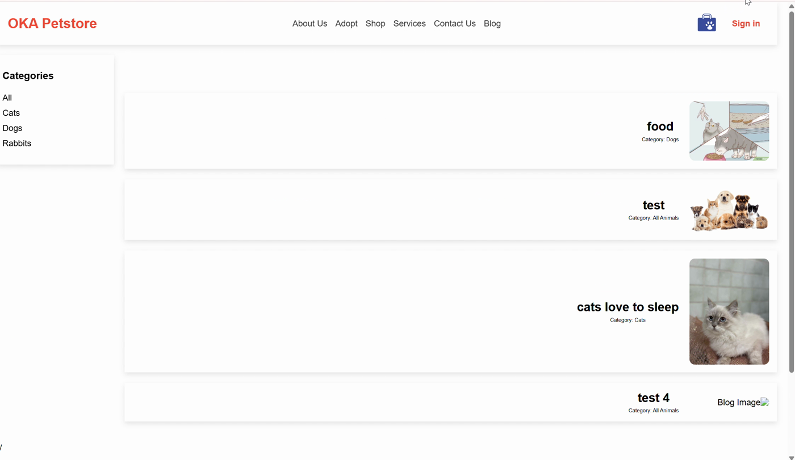
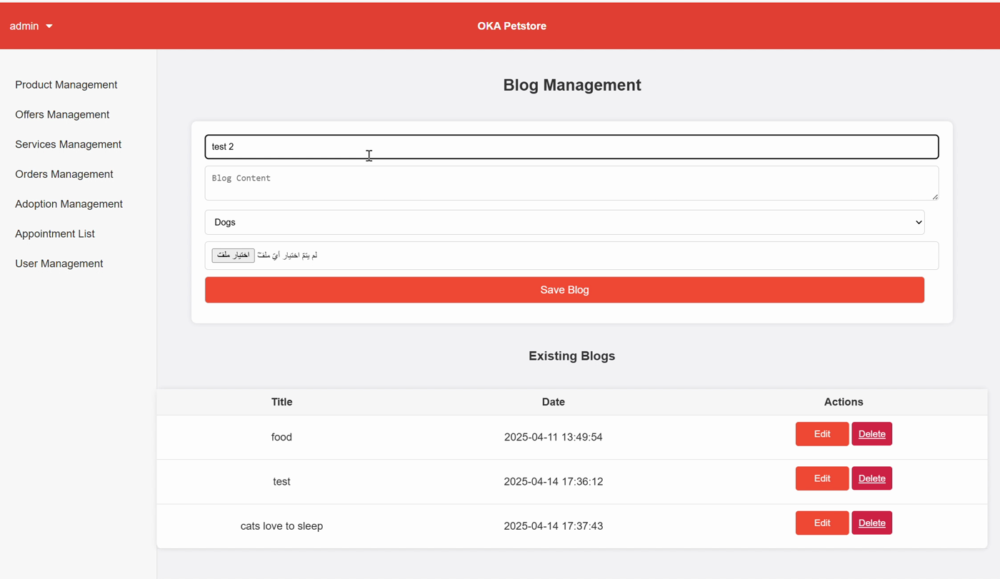
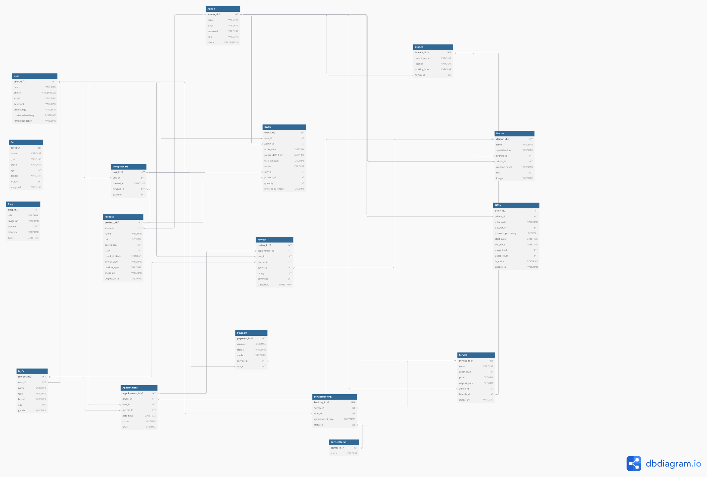

# 🐾 OKA Veterinary Clinics: Pet Store & Clinic Website

A full-stack web application for a veterinary clinic and pet store: shop for pet products, book vet appointments, adopt a pet, read the blog, and manage everything from admin and super-admin dashboards.

> Team project for a Web Development course, Imam Abdulrahman Bin Faisal University (IAU).
> Built with **PHP**, **MySQL**, **HTML/CSS** and **JavaScript**.
> *Student project. Not the official website of OKA Veterinary Clinics.*

  
  

🎬 A short demo of the blog management flow is in [`docs/blog-management-demo.mp4`](docs/blog-management-demo.mp4).

---

## ✨ Features

### 👤 Customers
- **Sign up / sign in** (customer passwords are hashed with `password_hash`), plus **reset password**
- **Shop:** browse pet products, add them to the **cart**, update quantities and **pay** at checkout
- **Services:** browse clinic services (checkups, dental care, grooming, lab tests…), **book an appointment** with a doctor at a branch, and add it to **Google Calendar**
- **My bookings:** view and manage appointments
- **Adoption:** browse pets, send an **adoption application**, or **find a new home** for your own pet
- **My pets:** save pet info and view it later
- **Blog:** read posts filtered by animal category
- **Reviews** for services, **profile settings** with a profile picture, cookie consent banner and toast notifications

### 🛠️ Admin dashboard
- Product, offer and service management
- Order management
- Adoption management
- Appointment list and booking status updates
- Blog management (create, edit and delete posts with images)
- User management, including each user's history

### 👑 Super admin
- Admin account management
- Branch management with working hours
- Doctor management

## 📄 Documentation

- [`docs/project-report.pdf`](docs/project-report.pdf): full project report with a description of every page and screenshots of the user, admin and super-admin flows
- [`docs/erd.pdf`](docs/erd.pdf): entity relationship diagram

## 🗄️ Database

MySQL database **`oka_petstore`**, with the connection set in [`db_connect.php`](db_connect.php).

It has 17 tables: `User`, `Admin`, `Branch`, `Doctor`, `Product`, `ShoppingCart`, `Order`, `Payment`, `Offer`, `Service`, `ServiceBooking`, `ServiceStatus`, `Appointment`, `Review`, `Pet`, `MyPet` and `Blog`.

  

## ▶️ How to run locally

1. Install **XAMPP** (Apache + MySQL + PHP).
2. Copy this folder into `xampp/htdocs/`.
3. In **phpMyAdmin**, create the database `oka_petstore` with the tables above.
4. Update the credentials in `db_connect.php` if yours are different (default: `root` with no password).
5. Open `http://localhost/<folder-name>/homepage.php`.

## 📁 Project structure

The site is a classic PHP app, with one file per page or action:

| Type | Examples |
|---|---|
| Customer pages | `homepage.php`, `Shop.php`, `Cart.php`, `services.php`, `appointmentBooking.php`, `adopt.php`, `blogs.php`, `aboutus.php`, `sitting.php` |
| Admin pages | `Product Management.php`, `Orders Management.php`, `Services Management.php`, `Adoption Management.php`, `Blogs Management.php`, `user management.php` |
| Super admin | `superadminhomepage1.php`, `Adminmanagement.php`, `Branchesmanagement5.php`, `managingdoctors3.php` |
| Actions / API | `add_*.php`, `update_*.php`, `delete_*.php`, `get_*.php`, `fetch_*.php`, `handle_payment.php` |
| Shared | `header.php`, `footer.php`, `db_connect.php`, `toast.js`, `cookie.php` |
| Media | `images/` (services), doctor photos, `ourstories*.mp4` |
| Upload folders | `uploads/` (products), `uploads_adoption/`, `uploads_blogs/`, `doc_pic/`, `profile_pics/` |
| Docs | `docs/`: report, ERD, screenshots, demo video |

---

🇸🇦 ملخص بالعربي

موقع ويب متكامل لعيادة بيطرية ومتجر حيوانات أليفة، مبني بـ PHP وMySQL. يقدر العميل يتسوق منتجات الحيوانات، ويحجز موعد عند طبيب، ويتبنى حيوان أو يلقى بيت جديد لحيوانه، ويقرأ المدونة.

وفيه لوحة تحكم للأدمن يدير منها المنتجات والعروض والخدمات والطلبات والتبني والمواعيد والمدونة والمستخدمين. وفيه سوبر أدمن يدير الأدمنز والفروع والأطباء.

مشروع جامعي، وما هو الموقع الرسمي لعيادات أوكا.

